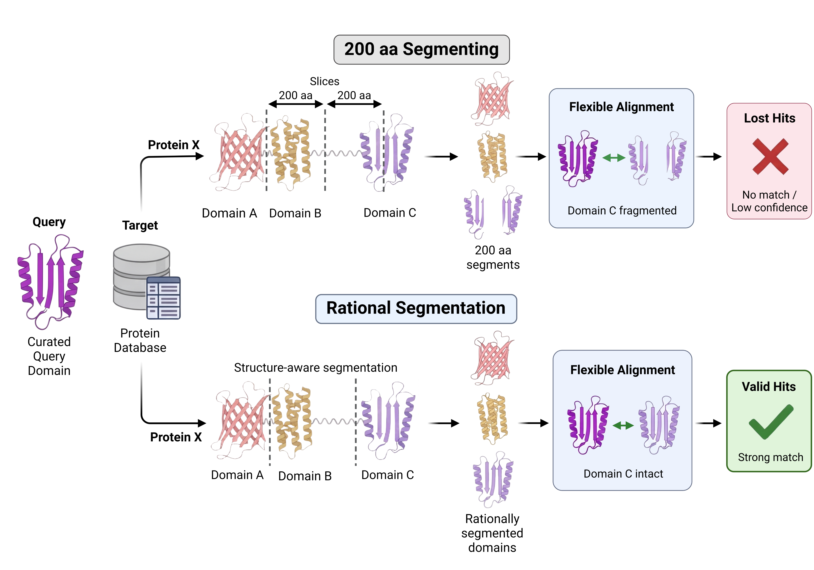

# Flexible Alignment Pipeline

Flexible alignment algorithms to find distant structural orthologs of proteins (in progress)

> **Status:** in progress  
> **Version:** v0.1  
> **Contact:** Visnu Chowdhury (pritom@udel.edu)  
> **Citation:** in progress  

---

## Overview

Computaitonally screening for PIP-binding domains across *Legionella pneumophila* effector space through flexible domain alignment.  



```
get protein IDs -> 01 get protein sequence -> 02 get/generate models -> 03 slice domains -> 04 flexible alignment -> 05 find concensus -> 06 validate hits -> 07 summarize -> report 
```

## Repository layout

```
flex-alignment/
|-- README.md                   # global instructions and layouts
`-- tools 
    |-- generate pdbs       
    |   `-- README.md           # instructions on how to get/generate alphafold protein models 
    |-- domain slicing 
    |   `-- merizo 
    |       `-- README.md       # how to set up and slice domains using merizo 
    `-- domain alignment  
        |-- README.md
        |-- fatcat 
        |   `-- README.md       # how to set up and do flexible alignment with FATCAT 
        |-- us-align
        |   `-- README.md       # how to set up and do flexible alignment with US-align
        `-- foldseek 
            `-- README.md       # how to set up and do flexible alignment with Foldseek 
```

## Requirements

### Software

| Tool      | Version   | Purpose                           |
|------     |---------  |---------                          |
| Python    |           | pipeline scripts                  |
| Bash      |           | pipeline scripts                  | 
| Merizo    |           | structure aware domain segmenting |
| FATCAT    |           | flexible structural alignment     |
| US-align  |           | flexible structural alignment     |
| Foldseek  |           | flexible structural alignment     |

---

## Troubleshooting

| Problem | Fix |
|---------|-----|
| common error | How to resolve |

---

## License

State the license (see `LICENSE`).

## Acknowledgements

Thanks to Dr. Karl R. Schmitz and Dr. M. Ramona Neunuebel for their supervision and guidance, and the Departments of Biological Sciences and Chemistry & Biochemistry and the Center for Bioinformatics and Computational Biology (CBCB) at the University of Delaware for support and HPC access.

## Funding

K.R.S. was supported by NIH NIGMS P20GM104316 and NIH NIAID/NIGMS R01AI171196. The BIOMIX computational resource was funded by Delaware INBRE (NIGMS P20GM103446), NIH S10OD028725, the State of Delaware, and the Delaware Biotechnology Institute.

---

### Steps 

- Get the latest **AlphaFold models** with their corresponding PAE (predicted alignemnt error) files (.pdb + .json) with `fetch_pdb_pae.py`. 
    - If needed convert the pdb/pae files' IDs into UniProt or Locus IDs with `convert_ids_uniprot_locus.py`
- Slice domains out with given start-end amino acid residues with `domain_slicer.py`
    - Domain slicer script requires biopython. Make sure it is installed before running (for any script requiring biopython)
    - Alternatively, have biopython installed in a virtual environment and run the script from that env. 
- Prepare all curated query domains in a query_dir. 
- Prepare the test set 
    - Domain-vs-domain (dvd): 
        - Use `merizo` to segment the domains of the test protein set. 
        - Once merizo output is obtained, segment the pdbs with the merizo coordinates by `merizo_domain_slicer.py`, from inside the pdb container. 
    - Domain-vs-200aa (dv200): 
        - Slice the pdbs into 200aa long segments with `fixed-length_slicer.py`

### Commands

```bash
# get pdb/pae files 
python3 fetch_pdb_pae.py -i legionella_effectors_368.csv

# convert IDs to corresponding uniprot/locus IDs
python3 convert_ids_uniprot_locus.py -i pdb_pae_dir -k key.csv -d u2l

# ----------
### query domain set 
# slice domains w coordinates
source /home/visnu/venvPyAnalysis/bin/activate # activates virtual env
python3 domain_slicer.py -i pdb_container_dir -c residue_coordinates.csv

# ----------
### dvd
# segment domains with merizo 
PDB_DIR="/dir/with/pdb/files"
TIMESTAMP=$(date +%Y_%m_%d_%H%M%S)
TSV_FILE="${PDB_DIR}/merizo_results_${TIMESTAMP}.tsv"

nohup python /fast_disk/visnu/merizo_work/Merizo/predict.py \
  -d cpu \
  -i "$PDB_DIR"/*.pdb \
  --iterate \
  --save_domains \
  > "$TSV_FILE" 2>&1 &

# check job status 
ps -p <job ID>

# manual check in the dir should show domain files being generated

# check merizo segmentation outputs 
for d in *.domains; do echo "=== $d ==="; cat "$d"; echo ""; done

# segment domains according to merizo output; min domain taken 83aa 
python3 slice_merizo_domains_v3_discontDom_minLen.py -m 83

# ----------
### dv200
python3 fixed-length_slicer.py -i dir_w_FL_pdbs/ -s 200

# ----------
### FATCAT dvd/dv200 
python3 fatcat_updated.py --query query_domains/ --target target_domains_or_segments/ --log-threshold 3

# generate histogram plots 

```

